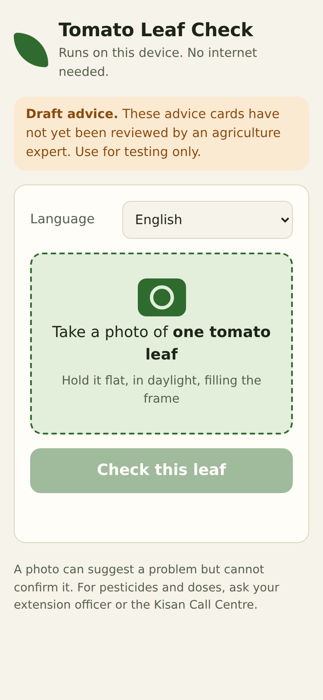
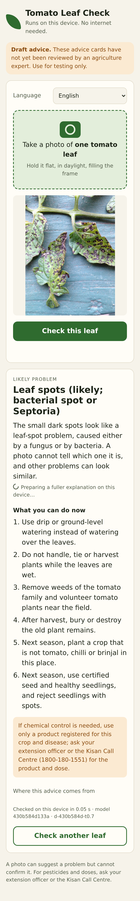
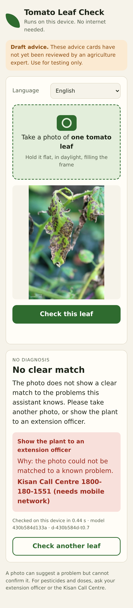

# Grounded Field Assistant: Offline Tomato Leaf Diagnosis and Advice on Arm

**Arm Bharat AI-SoC Challenge 2026-27 · Problem Statement 1 (Offline Crop Disease/Pest Detection and Advisory) · Phase 1 report**

Members: Nachaegari Sreyesh Kumar, T Sai Vardhan, Ch Saivenkat · Faculty mentor: Dr S Swetha · Repository: https://github.com/shreynachaegari-glitch/arm-bharat-ps1 · Date: 24 Nov 2026

> **Status in one paragraph.** The full offline pipeline runs end to end. A photo goes through a quality gate, an EfficientNet-B0 ExecuTorch model, an abstaining decision step, an expert-style advice card, and a Llama 3.2 1B (INT4, ExecuTorch) explanation that is checked before it is shown. It runs inside a local web app, and 271 automated tests pass. Accuracy was measured on an x86 Linux laptop. Speed and memory were measured on an Arm phone (Nothing Phone (2), Snapdragon 8+ Gen 1, Android 16, offline) and on the laptop; our Raspberry Pi 5 has not arrived, so there are no Pi numbers (Section 8). On the phone the same v7 model gives the same answers as on the laptop (30 of 30 photos, largest logit difference 0.000006), and Llama explains a leaf in about 6 seconds. On the sealed external test, scored once after the thresholds were frozen, the deployed model **passed every blocking gate**. It answered 33% of supported field photos with 7% of those answers wrong, never called a sick plant healthy (0 of 228), and let 3% of unsupported problems through (Section 5.3). The other accuracy figures are out-of-fold development estimates.

**Where to find what:** methodology: Sections 2-4 and 6 · results: Section 5 · hardware utilization: Section 8 · optimization techniques: Section 8.1 · limitations: Section 10.

---

## 1. Problem and scope

A smallholder needs an answer in the field, often with no network. PS1 asks for an on-device assistant: a crop image in, a likely problem and practical, safe advice out. The vision model runs separately from a Llama-family model deployed with ExecuTorch.

We chose depth over breadth for Phase 1:

| In Phase 1 | Deliberately out of Phase 1 (why) |
|---|---|
| One crop: **tomato** leaves | Maize, other crops (one stable crop first) |
| 3 disease outputs + healthy + "other problem": early blight, late blight, leaf spot (bacterial spot or Septoria, merged), healthy, other | Splitting leaf spot (the two were confused on field photos) |
| Non-chemical, sourced actions from advice cards; a fixed line that sends chemical questions to the extension officer / Kisan Call Centre | **Pesticide names and doses** (a wrong dose harms people and crops; needs expert review) |
| Abstaining when unsure ("no clear match") | Forcing an answer for every photo |
| English UI and advice | Hindi/Telugu advice (needs reviewed translations; Section 10) |
| Severity: *not shown* | A severity % that has not been validated |

## 2. System design

```
 photo ─► quality gate ─► input gate* ─► vision .pte (EfficientNet-B0, XNNPACK, FP32)
            (blur, dark,      (tomato        │ logits
             bright,           leaf?)        ▼
             unreadable)               decision engine: temperature T, threshold t, 'other'
                                             │ Finding {label | abstain reason, versions}
                                             ▼
                          reviewed advice card (deterministic lookup) ──► SCREEN 1 (at once)
                                             │ card's reviewed text only
                                             ▼
                     Llama 3.2 1B INT4 .pte (ExecuTorch) rewrites it in simpler words
                                             │ whole output buffered, never streamed
                                             ▼
                     checker + guards ── pass ──► SCREEN 2 (Llama text)
                                       └─ fail ──► SCREEN 2 keeps the reviewed text
 * input gate is a placeholder in Phase 1 (assumes the farmer photographed tomato); see Section 10.
```

**Model split.** Vision decides *what* (a label or an abstention). Deterministic code picks the card and the actions, so Llama never chooses advice. Llama only rewrites the card's reviewed text in simpler words. The language model therefore cannot invent a diagnosis, a product or a dose. The worst case is a fallback to the reviewed text. The two models run on separate single-thread lanes, so Screen 1 never waits for Llama (Section 8).

**Contracts.** Every stage passes typed, frozen objects (`ps1/contracts.py`). Validators enforce the safety rules at runtime, not just in tests:
- An abstained finding cannot carry a label or a card.
- Actions must equal the card's actions.
- Any text marked as coming from Llama is re-checked by the checker inside the `Advice` validator.

## 3. Data

| Source | Use | Licence |
|---|---|---|
| PlantVillage (`spMohanty/PlantVillage-Dataset@7f7ecc7e`) | lab-style training/validation; other crops as non-tomato material | CC BY-SA 3.0 |
| PlantDoc (`pratikkayal/PlantDoc-Dataset@5467f601`) | real-field photos: half for development, half **sealed as the final test** | CC BY 4.0 |
| Maharashtra tomato set (Mendeley `rv3kxfv47y` v1, BSKKV Dapoli) | **Indian field photos, kept out of training** as an India check | CC BY 4.0 |

- 56,989 images in a pinned manifest (sha256 recorded).
- Duplicates were removed with exact hashes plus perceptual hashes (pHash/dHash). An exhaustive audit then removed 187 near-duplicate copies that crossed splits. The sealed splits are refused by the data loader unless an explicit final-evaluation flag is set.
- Supported-class field images: **263 for development**, **259 sealed**. Unsupported field problems: 116 (PlantDoc) + 34 (Indian) for development, 107 + 35 sealed.

**Why the Indian set stays out of training.** An ablation (Section 5.2) showed that a model trained on these 20 early-blight photos learned the *source* (camera and background) rather than the disease. Indian leaf-miner photos were called early blight. With them excluded (recipe "v5b"), false accepts of novel Indian problems at t=0.7 fell from 26.5% to 5.9%.

## 4. Vision model

**Recipe (v5b + weight averaging, deploy model "v7_final"):**
- Model: EfficientNet-B0, ImageNet-pretrained; backbone learning rate × 0.1.
- Training: 10 epochs × 5,000 samples, field images oversampled 8×.
- Background compositing: leaves are pasted onto field backgrounds with p = 0.5, because PlantVillage's plain backgrounds are a known shortcut.
- Abstention: an outlier-exposure "other problem" class.
- Folds: two stratified folds over the field development set, used for out-of-fold estimates.
- Weight averaging: an exponential moving average (EMA) of the weights, decay 0.998 from epoch 4, BatchNorm statistics included, chosen over the plain last epoch by a rule fixed before the results (Section 4.4).
- Deploy model: trained once more on all non-sealed field data (seed 0), EMA weights exported.

### 4.1 Baseline: MobileNetV3-Small vs EfficientNet-B0

Same recipe and folds, one seed each; only the architecture differs. Out-of-fold dev estimates; the `.pte` latencies are from x86. Section 4.4 shows the seed-to-seed spread of this recipe is about ±0.015 F1, so the 0.002 F1 gap below is noise.

| model | field macro-F1 | t=0.7 answers / error | t=0.8 answers / error | t=0.7 false accept, novel Indian problems | .pte MB | x86 ms/img |
|---|---|---|---|---|---|---|
| **EfficientNet-B0** (deployed) | 0.695 | 49% / 11% | 33% / 10% | 6% | 16.1 | 5.3 |
| MobileNetV3-Small (baseline) | 0.697 | 40% / 12% | 27% / 11% | 12% | 6.2 | 2.3 |

Macro-F1 is equal within noise (n = 263). At the operating thresholds, EfficientNet-B0 answers more photos at similar error and lets fewer novel Indian problems through, so it is deployed. Vision costs milliseconds against seconds for Llama, so the larger model costs nothing the farmer notices.

### 4.2 What "answers" and "error" mean

The model may abstain. *Answers* is the share of supported-disease field photos that get a diagnosis. *Error* is the share of those answers that are wrong. We report both because a model that abstains on everything has zero error and is useless. The threshold t trades the two off (Section 6.4).

### 4.3 Export to ExecuTorch

- **Pipeline:** `torch.export` → `to_edge_transform_and_lower` with the XNNPACK partitioner → `.pte`.
- **FP32 parity:** exact. v7_final: macro-F1 0.961 on lab validation for both PyTorch and `.pte` (n = 1,259), top-1 agreement 1.000, largest logit difference 0.0005; 16.1 MB, 4.8 ms/image on x86.
- **INT8:** post-training quantization failed parity (macro-F1 −0.175, top-1 agreement 0.766), so **FP32 is deployed**. INT8 is kept only as a latency reference.
- **Binding:** the decision config (temperature, threshold, class order) is bound to the `.pte` sha256. A mismatched pair refuses to run.

### 4.4 Seeds and weight averaging

A single training run is one draw. We trained the recipe with seeds 0, 1 and 2 on the same two folds (6 runs). Each run saved both its last epoch ("raw") and its EMA weights, so the two arms share data order and augmentations. Before any result we fixed the rule: adopt EMA if its mean field macro-F1 is not lower than raw and its mean false accepts of novel Indian problems at t = 0.78 are at most 3 points higher.

| arm | field macro-F1, mean ± sd (min-max) | t=0.7 answers / error | t=0.78 answers / error | t=0.78 false accept: seen-type / novel Indian |
|---|---|---|---|---|
| raw last epoch | 0.684 ± 0.015 (0.667-0.695) | 49% / 16% | 36% / 14% | 5.5% / 0% |
| **EMA (deployed)** | **0.695 ± 0.005 (0.691-0.700)** | 48% / 15% | 35% / 12% | 6.6% / 0% |

- The rule picks **EMA**. Its main gain is stability: the worst seed rises from 0.667 to 0.691 and the spread shrinks threefold.
- The earlier single run (F1 0.695, 11% error at t = 0.7) turned out to be the luckiest raw seed. The 3-seed means above are the honest numbers and replace it in Section 5.1.
- Not covered by the rule, reported as found: EMA lets about one point more seen-type unsupported problems through at t = 0.78 (6.6% vs 5.5%), inside the seed spread (sd about 3 points).

## 5. Evaluation of the vision path

### 5.1 Development estimates (deployed recipe, out-of-fold, mean over 3 seeds)

Known-class field macro-F1 0.695 ± 0.005. Operating points (seed sd in brackets, percentage points):

| threshold t | answers | error of answers | false accept: seen-type unsupported | false accept: novel Indian |
|---|---|---|---|---|
| 0.6 | 63% (±0) | 16% (±2) | 18% (±1) | 7% (±2) |
| 0.7 | 48% (±2) | 15% (±3) | 14% (±0) | 5% (±2) |
| 0.78 | 35% (±3) | 12% (±1) | 7% (±3) | 0% (±0) |
| 0.8 | 31% (±1) | 11% (±2) | 5% (±1) | 0% (±0) |

n = 263 known-class field photos, 116 seen-type and 34 novel Indian unsupported photos.

### 5.2 India check (deploy model, never-seen Indian photos)

Deploy model v7_final (the earlier v6_final in brackets):
- **Unsupported Indian problems:** **0 of 34 accepted**; all abstained (v6: 1 accepted, as healthy).
- **Indian early blight:** **0 of 20 correct**; all 20 abstained (v6: 19 abstained, 1 called leaf spot).

The model is *safe* on Indian photos (it abstains rather than misdiagnoses) but not yet *useful* on Indian early blight. Consented, expert-labelled Indian field photos are our top data need for Phase 2.

### 5.3 Sealed final test

Run once on 21 Nov 2026 (19:46 IST, x86), after the team froze the configuration (Section 6.4). The harness (`ps1/vision/final_eval.py`, independently reviewed) wrote a lock that pins the hashes of the model (`6ecd519a…`), decision config (`d-6ecd519a-t0.8`), gates file, data manifest and quality thresholds (`q1-dev`), and refuses any re-run with changed pins. Nothing was tuned after it. Result file: `runs/final_eval/final_eval.json`.

| metric (t = 0.80) | sealed result | 95% interval | gate | dev estimate (3 seeds) |
|---|---|---|---|---|
| answers (supported field photos) | **32.8%** (85/259) | 27-39% | ≥ 25%, **pass** | 31% |
| error of answers | **7.1%** (6/85) | 3-15% | ≤ 30%, **pass** | 11% |
| false accept: seen-type unsupported | **2.8%** (3/107) | 1-8% | ≤ 10%, **pass** | 5% |
| sick plant called healthy | **0%** (0/228) | 0-1.7% | ≤ 3%, **pass** | ~1% |
| false accept: novel Indian problems | 5.7% (2/35) | 2-19% | ≤ 30% (report only), pass | 0% |
| unsupported problem called healthy | 0.9% (1/107) | 0.2-5% | ≤ 5% (report only), pass | — |

- The quality gate rejected 10 of the 259 supported photos; they count as unanswered.
- The sealed numbers sit inside the dev seed spread: the dev estimates were not optimistic.
- **What this does and does not show.** The supported set is PlantDoc (mostly web images of field plants), so the system is safe and useful on images like those. The input gate was waived (Section 10), so the false-accept figures are an upper bound. The run was on x86; the Pi golden check (same answers on the Pi build) is still to come. Two novel Indian problems were accepted, against none in development, and the small sample (35) gives a wide interval.

### 5.4 After the sealed run: more field data (v8)

The rule for this test was written down before training. We added 1,872 Bangladesh field photos of the supported diseases, plus 3,522 photos of other leaf problems, to training (model "v8"; two Daffodil International University sets on Mendeley, CC BY 4.0). Any copy of an image already in our data, sealed images included, was removed. A third Bangladesh set (NEU, CC BY 4.0) was kept out of training and used as a new external test: 1,488 photos of supported diseases and 972 of unsupported ones. The threshold stayed at 0.80.

| at t = 0.80 | v7 (submitted) | v8 |
|---|---|---|
| PlantDoc dev, out-of-fold macro-F1 (3 seeds) | 0.695 ± 0.005 | 0.709 ± 0.026 |
| PlantDoc dev: error of answers / seen-type false accept | 11% / 5% | 10% / 7% |
| NEU: forced-choice macro-F1 | 0.52 | 0.57 |
| NEU: answers / error of answers | 29% / **63%** | 19% / **13%** |
| NEU: sick called healthy / unsupported accepted | 0% / 3% | 0% / 0% |
| Indian unsupported photos accepted | 0/34 | 1/34 (called healthy) |

v8 passes every check in the rule. Even so, **v7 remains the submitted model**: it is the model the sealed test measured, and v8 has no sealed test. Points to note:

- **v7 is confidently wrong on NEU.** It called 478 of 496 NEU early-blight leaves "leaf spot". v8 is much less over-confident on these photos, which is most of the error drop.
- **The gain is partly style match.** The DIU training photos and the NEU test photos are both single leaves photographed on white paper, so NEU is a new source but a familiar style for v8.
- **v8 makes a new mistake.** It mixes up NEU late blight with early blight.
- **The PlantDoc gain is within noise.** The improvement is inside the spread between seeds.
- **One harmful miss in India.** v8 called one Indian "insect attack" leaf (it looks nearly healthy) healthy.

Phase 2 will build on v8 once it has its own fresh test.

### 5.5 Two more attempts after v8 (neither adopted)

Both attempts used the same method: one rule, written down before training, and the NEU set split into a development half (for choosing) and a test half (for the final check). The score S is the mean of the PlantDoc out-of-fold F1 and the NEU development F1. The threshold stayed at 0.80.

**v9: training changes only, same network and speed.** Four variants were screened against v8 with one seed each. A variant needed a gain of at least 0.02 in S and no guardrail broken.

| variant | S | PlantDoc F1 | NEU-dev F1 | NEU-dev error | outcome |
|---|---|---|---|---|---|
| v8 (baseline, seed 0) | 0.605 | 0.705 | 0.505 | 24% | |
| v9a: twice the training | 0.614 | 0.697 | 0.531 | 12% | gain too small (+0.009) |
| v9b: backbone learning rate ×3 | 0.601 | 0.730 | 0.472 | 15% | no gain |
| v9c: full fine-tune (×10) | 0.572 | 0.692 | 0.451 | 32% | no gain, more errors |
| v9d: Bangladesh photos ×2 | 0.580 | 0.681 | 0.479 | 21% | no gain, more PlantDoc errors |

No variant won. Every difference is about the size of the seed-to-seed noise.

**v10: a larger network (EfficientNet-B2, 260 px).** It passed the first stage (mean of three seeds) and failed the second (final model on photos it was not chosen on):

| stage | check | v8 | v10 | limit | result |
|---|---|---|---|---|---|
| 1 | mean S, 3 seeds | 0.591 | 0.626 | ≥ 0.606 | pass |
| 1 | five error guardrails | | | | all pass |
| 2 | NEU-test forced-choice F1 | 0.582 | 0.461 | ≥ 0.582 | **fail** |
| 2 | NEU-test error of answers | 11% (16/141) | 18% (28/155) | ≤ 14.3% | **fail** |
| 2 | Indian photos, wrong accepted answers | 0/20 | 2/20 | 0 | **fail** |
| 2 | NEU-test sick called healthy; unsupported accepted | 0/486; 0/486 | 0/486; 0/486 | ≤ 1%; ≤ 3% | pass |
| 2 | Indian unsupported called healthy | 1/34 | 1/34 | ≤ 1 | pass |
| 2 | x86 latency of the `.pte` | 5.1 ms | 9.3 ms | ≤ 15.2 ms | pass |
| 2 | `.pte` minus FP32 macro-F1 | 0.000 | 0.000 | ≥ −0.02 | pass |

v10 was rejected. Both wrong Indian answers called a diseased leaf healthy, the most harmful kind of error. The larger network looked better on the photos used to choose it and did worse on new ones. Caveats: each final model is one seed, and the 95% intervals of the two NEU-test error rates overlap (v8 7-18%, v10 13-25%). Result files: `runs/v9_screen.json`, `runs/v10_seeds.json`, `runs/v10_summary.json`.

## 6. Llama through ExecuTorch

### 6.1 Deployment

| item | value |
|---|---|
| Model | Llama 3.2 1B Instruct, SpinQuant **INT4** (`executorch-community/Llama-3.2-1B-Instruct-SpinQuant_INT4_EO8-ET` @ `911221e0`) |
| Quantization | 4-bit weights, 8-bit dynamic activations, group size 32 (`8da4w`), XNNPACK backend; Meta's published quantized variant |
| `.pte` | 1.14 GB, sha256 `8715cdba…cda3b` (matches the Hugging Face LFS id) |
| Runtime | ExecuTorch **v0.6.0** (`e67ef3b1`), the release the `.pte` was exported with; native `llama_main` runner |
| Decoding | greedy (temperature 0), max 120 new tokens, hard timeout, process-group kill |

The challenge names no precision. We use Meta's own INT4 SpinQuant export, because full-precision 1B weights (~2.5-5 GB) would be slower on a Pi CPU and add nothing for card-grounded rewriting.

### 6.2 Runtime check (G1, x86, idle, 10 runs)

- Runs: 10 of 10 succeeded, all with identical output.
- Speed: load 1.55 s; time to first token 1.07 s; prefill 144 tok/s; decode **48.9 tok/s**; total 4.1 s.
- Memory: peak RSS **1.64 GB**.

### 6.3 Keeping the 1B model faithful

The first prompt asked Llama to *explain* the card. The real model added facts the card does not contain, and our word-list checker let them through:
- leaf spot: "bacterial spot, which is also caused by Septoria"
- late blight: weather causes that were not on the card

The fix has two parts:

1. **Rewrite mode.** Llama only rewrites the card's reviewed text in simpler words: "Use only the facts given… Keep the warning that a photo cannot confirm the problem."
2. **Guards on generated text**, enforced both in the wrapper and in the `Advice` validator:

| Guard | What it does |
|---|---|
| Lexical checker (c4) | Rejects chemical and dose words, units and digits, affirmative certainty words, harvest-safety claims, non-English script, over-long or cut-off text. Negated hedges ("a photo cannot tell for sure") are allowed. |
| Required warning | The output must keep the "a photo cannot confirm" warning. |
| Refusal reject | Model refusals are rejected. |
| Possible causes | If the card lists more than one possible cause, the text must name all of them or none. |
| Clean-up | A preamble line and wrapping quotes are removed; the clean-up only deletes text. |

Any failure shows the reviewed card text instead, so the farmer always sees reviewed content. Llama is not called when there is nothing to explain (healthy).

**Result with the real model** (`scripts/llama_card_check.py`, x86):

| card | shown | reason | text shown to the farmer |
|---|---|---|---|
| early blight | reviewed text | 4 sentences (limit 3) | "The spots with rings on the older leaves look like early blight. A photo cannot confirm the disease, and other leaf spots can look similar." |
| late blight | **Llama** | passed | "Look at the dark spots on your plants. They might be late blight, which can spread quickly in wet weather. A photo can't tell for sure, so be careful not to jump to conclusions." |
| leaf spot | **Llama** | passed | "Look at the small dark spots on your plants. They might be caused by a fungus or bacteria. A photo can't tell which one it is, and other problems can look similar." |

Greedy decoding makes each card's output deterministic. Each of these took about 4 s on x86.

### 6.4 Decisions frozen before the sealed run (21 Nov 2026)

- **Threshold t = 0.80** (the earlier placeholder was 0.7).
- **Gates** (blocking): sealed accepted error ≤ 30%, seen-type false accept ≤ 10%, answers ≥ 25%, sick called healthy ≤ 3%. Report only: novel Indian false accept ≤ 30%, unsupported called healthy ≤ 5%.
- **Quality thresholds `q1-dev`:** the clipped-pixel limit was raised from 25% to 70%. The old limit rejected 7.2% of good development photos, mostly leaves on white or black backgrounds (a leaf held against paper looks the same); the new one rejects 1.5% and still catches 88% of 4× over-exposed copies.
- **Input gate waived** for this run (not built yet).

The gate sheet, regenerated for the deployed model's recipe (seed-0 EMA folds), estimated the chance of passing all blocking gates at each threshold:
- at t = 0.7, about 17% (the seen-type false-accept gate fails)
- at t = 0.78, about 67%
- at t = 0.8, about 79%, answering about a third of supported photos (chosen)

## 7. The application

`ps1/app`: a local web app (Flask served by waitress), started with `scripts/run_app.sh` (v7 by default; `--model v8` loads the Section 5.4 model and shows a banner saying it is not the submitted model).

- **Fully offline.** The page ships its own CSS/JS and system fonts. A Content-Security-Policy (`default-src 'self'`) blocks any other origin. A browser test confirmed zero requests leave the device.
- **Two ways to use it:**
  - the Pi's own screen at `localhost`
  - a phone on the Pi's Wi-Fi hotspot. Photos use `<input type=file capture>`, which works over plain HTTP; live camera access would need HTTPS.
- **Screen 1 at once, Screen 2 when checked.** The page shows a progress note while Llama works. A new photo cancels the phone's own not-yet-started explanation and ignores stale responses.
- **Privacy.** The photo is saved under a server-chosen name, used once and deleted as soon as Screen 1 is built. No GPS and no accounts.
- **Robustness:**
  - upload size limit (15 MB) and pixel limit (64 MP), checked from the header before decoding
  - bounded queue (busy → HTTP 503)
  - generic error messages
- **Honesty in the UI:**
  - a visible "Draft advice" banner until the cards are expert-reviewed
  - model confidence is never shown as a percentage
  - the model and decision versions are printed on every result

| Home | Screen 1: card at once | Screen 2: checked Llama text | No clear match |
|---|---|---|---|
|  |  |  |  |

Screens: `docs/app-screens/`. Demo video: see the submission form (a recording on the Arm phone is planned; the earlier `docs/demo/ps1_app_demo_x86_20261121.mp4` was recorded on the x86 laptop and is labelled as such). Screens and video were made with v6_final (the same recipe without weight averaging); the app now loads v7_final.

## 8. Hardware utilization: latency, memory and power

| Measurement (x86 laptop, idle CPU) | value |
|---|---|
| Screen 1 total (quality gate → card), p50 over 50 runs | **79 ms** (vision inference p50 44 ms) |
| Screen 1 wall time through the app (HTTP round trip), idle / while a Llama call runs | 0.34 s / 0.12 s (single measurements) |
| Llama explanation, 4 threads / 2 threads (p50) | **4.6 s** / 6.5 s |
| Peak RSS: vision process / Llama runner | 0.56 GB / 1.64 GB (≈ 2.2 GB total) |

**On an Arm phone (25 Nov 2026).** Nothing Phone (2) (model AIN065, Snapdragon 8+ Gen 1 `SM8475`, 11.5 GB RAM, Android 16), running the app and both models inside Termux with no network, from the bundle built by `scripts/phone/` (cross-built for Arm64 from the same pinned ExecuTorch 0.6.0 commit). Same v7 model file as the laptop (sha256 `6ecd519a…`).

| Measurement (phone, FP32 v7, 4 threads for Llama) | value |
|---|---|
| Same answers as the laptop (golden check, 30 photos) | **30/30 top-1 identical**, largest logit difference 6.2e-06, 0 tensor mismatches |
| Vision only: Screen 1 total, p50 / p95 | **37.9 ms** / 98.1 ms; peak RSS 585 MB |
| Screen 1 with Llama configured, p50 / p95 | 50.8 ms / 145.0 ms |
| Llama explanation through the pipeline, 4 threads / 2 threads (p50) | **4.99 s** / 5.87 s |
| Llama runner alone, 10 runs: decode / time to first token / total (median) | **30.7 tok/s** (19.7-31.9) / 1.23 s / **6.4 s** (8.9 s worst) |
| Llama peak RSS | **1.64 GB** |
| Llama outputs | 10 of 10 runs succeeded, all identical |

- **Caveat on these phone numbers.** Our own harness marked every phone run *contaminated (busy CPU)*, because Android's load average was above the idle limit; we cannot show the phone was idle, so treat the times as upper-leaning figures. Android also schedules the cores itself, and the phone ran through Termux, not as a native app. The phone was not placed on a power meter, so there is no power figure. Evidence: `docs/phone/` (terminal photos of the run).
- **What this shows.** The same ExecuTorch build runs both models on an Arm phone with no internet, gives the laptop's answers exactly, and fits easily in memory (about 2.2 GB for both models, on a phone with 11.5 GB).

- **Which model was timed on the laptop:** this run used an earlier checkpoint with the same EfficientNet-B0 architecture and export path as v7_final; only the weights differ. CPU: Intel Core i9-13905H.
- **What runs where:** both models run on the CPU through ExecuTorch's XNNPACK backend (NEON kernels on Arm). No GPU or NPU is used, so the same build needs no add-on board on the Pi.
- **Raspberry Pi 5 (8 GB):** *not measured*. The Pi has not arrived. The same benchmark matrix (`scripts/g2/bench_matrix.json`) runs there unchanged. It records p50/p90/p95/p99, RSS, `vcgencmd measure_temp` and throttling flags. A run is flagged *contaminated* if the CPU was busy, because we saw vision rise from 5 ms to ~900 ms on a loaded CPU.
- **Power:** not yet measured. On the Pi we will read idle / Screen 1 / Llama power with an inline USB-C power meter and report energy per diagnosis.
- **Memory fit:** the measured 2.2 GB fits the 11.5 GB phone, and would also fit an 8 GB Pi 5 and a 4 GB board.

### 8.1 Optimization techniques

| Technique | What we did | Measured effect (x86) |
|---|---|---|
| Quantized language model | Llama 3.2 1B as Meta's SpinQuant INT4 `.pte` (4-bit weights, 8-bit dynamic activations) | 1.14 GB file, 1.64 GB peak RSS, 48.9 tok/s |
| Small vision network | EfficientNet-B0 at 224 px, FP32 through XNNPACK | 16.1 MB, 4.8 ms/image in the export test loop (44 ms p50 inside the full app run, table above); B2 at 260 px costs 9.3 ms and was rejected (Section 5.5) |
| INT8 vision, tried and rejected | post-training quantization of the earlier v6_final, 512 calibration images | 4.4 MB (from 16.1) and 4.6 ms, but macro-F1 −0.175, so FP32 ships |
| Two separate lanes | vision and Llama each have their own single-thread queue | Screen 1 no longer waits for a running Llama call: 5.1 s when queued behind it, 0.12 s on its own lane (single measurements) |
| Cheap checks first | size limit read from the image header, then the quality gate, then the network | oversized files are refused before any decode; blurred or dark photos never reach the network |
| Less text to generate | Llama only rewrites one short card text, at most 120 tokens, greedy | about 4 s per explanation |
| Skip needless work | Llama is not called for a healthy leaf or an abstention; a new photo cancels older waiting jobs | those requests cost only Screen 1 |
| Thread count | Llama timed at 4 and 2 threads | 4.6 s against 6.5 s (p50) |

Accuracy-side choices (weight averaging, field oversampling, background compositing, the "other problem" class and the abstention threshold) cost nothing at run time; they are described in Section 4.

## 9. Reproducibility, phone and Pi readiness

- **Pinned stack.** executorch 0.6.0, torch 2.7.0 (CPU), torchvision 0.22.0; `requirements.lock` holds all versions.
- **Phone build path.** `scripts/phone/build_bundle.sh` cross-builds ExecuTorch 0.6.0 and the Python bindings for Arm64 on the x86 laptop (Debian's GCC 12, the same pinned commit) and packs an Arm64 Debian root file system, the models and the app into one file. `proot` in Termux runs it, so nothing is compiled on the phone. `scripts/phone/README.md` has the steps. The golden check and the benchmark ran on the Nothing Phone (2) (Section 8).
- **Pi build path.** PyPI has **no aarch64 wheel for executorch 0.6.0**. We build the Python bindings from the pinned source in a container (`scripts/g2/Containerfile.pybind`, Python 3.12). On x86 this build matches the reference exactly (golden check 30/30, max logit difference 0.0). The aarch64 build itself is proven only once the Pi arrives. The runbook is `scripts/g2/README.md`:
  1. preflight
  2. tests
  3. golden check
  4. benchmark matrix
  5. Llama runner
  6. optional llama.cpp cross-check
- **Tests.** `python -m pytest` runs 271 tests: contracts, quality thresholds, checker, Llama wrapper (fake runners), pipeline branches, app endpoints, export parity, weight averaging, the seed decision rule and the sealed-harness safeguards.
- **Reports from artifacts.** `scripts/make_report.py` regenerates every table from run files and aborts if tests fail.

## 10. Limitations (stated plainly)

1. **No Pi numbers, and the phone runs were flagged.** Latency and memory come from an x86 laptop and one Arm phone (every phone run marked contaminated by our own harness, running through Termux). Power was not measured.
2. **One sealed test, PlantDoc-like images.** The sealed test (Section 5.3) passed, but its supported photos are PlantDoc images, and it ran with the input gate waived and on x86. All other accuracy numbers are out-of-fold development estimates.
3. **India gap.** The model does not yet recognise Indian early blight (0/20). It abstains, which is safe, but the assistant is not yet useful on that disease.
4. **Abstains often.** At t = 0.80 it answers about a third of supported field photos (sealed: 33%). This is a deliberate trade for low error (sealed: 7%) and for never calling a sick plant healthy.
5. **Input gate not built.** The app currently assumes the photo is a tomato leaf. A non-plant or other-crop photo can reach the disease model, and the quality gate and "other" class only partly cover this.
6. **Draft cards.** The advice cards are sourced but **not yet reviewed by an agriculture expert**. The app says so on screen.
7. **English only.** Hindi/Telugu advice waits for reviewed translations. Generated text is restricted to English by the checker.
8. **Limited Llama checks.** The 1B model's rewrites pass our checks on 2 of 3 cards. The checker is lexical plus card-aware rules, not a proof of faithfulness. Anything it cannot verify falls back to reviewed text.
9. **No severity.** No severity estimate is shown.

## 11. Phase 2 plan

| Item | What |
|---|---|
| Device bring-up | native Android app (no Termux) and Pi 5 numbers and power, once boards are available; optionally the AI HAT+ for vision |
| Indian field data | consented, expert-labelled photos; retrain and re-check |
| Input gate | MobileNetV3-Small INT8 gate (tomato leaf / other plant / non-plant), ~2 ms on Pi 5 per Arm's benchmark |
| Pests | **IP102**, a small, verified subset of tomato pests (e.g. *Tuta absoluta* / leaf miner, whitefly) |
| Voice | local speech recognition (faster-whisper) for English/Hindi questions, mapped to a fixed set of questions so voice never changes the diagnosis; Telugu via Indic speech models |
| Languages | reviewed Hindi and Telugu cards |
| Severity | a light leaf/lesion segmentation model (U-Net style) for a *validated* visible-lesion %, and to remove background bias |
| Soil and nutrients | soil type, pH, NPK, moisture, temperature, rainfall and district → fertiliser/irrigation guidance, as a separate reviewed module |

## 12. Licences and credits

- **Datasets:** PlantVillage (CC BY-SA 3.0), PlantDoc (CC BY 4.0), Maharashtra tomato dataset (CC BY 4.0); for Section 5.4 only: Daffodil International University tomato leaf sets (Mendeley `jttrv2w27r`, `93h9p62kg4`) and the NEU Bangladesh tomato set (Mendeley `9jxvtgh325`), all CC BY 4.0.
- **Llama 3.2:** used under the Llama 3.2 Community License ("Built with Llama").
- **Software:** ExecuTorch and PyTorch (BSD).
- **Advice cards:** cite their sources (e.g. UC IPM) inside each card.
